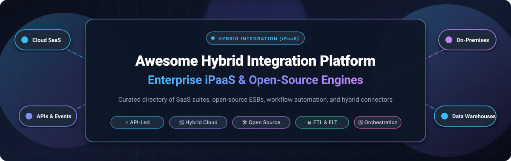

# 🌐 Awesome Hybrid Integration Platform (iPaaS) Ecosystem

<p align="center">
  
</p>

<p align="center">
  <a href="https://github.com/ishandutta2007/Awesome-Awesome-Awesome"></a><a href="https://discord.gg/jc4xtF58Ve"></a>
  <a href="https://github.com/ishandutta2007/Awesome-Hybrid-Integration-Platform-Ipaas/stargazers"></a>
  <a href="https://github.com/ishandutta2007/Awesome-Hybrid-Integration-Platform-Ipaas/network/members"></a>
  <a href="https://github.com/ishandutta2007/Awesome-Hybrid-Integration-Platform-Ipaas/issues"></a>
  <a href="https://github.com/ishandutta2007/Awesome-Hybrid-Integration-Platform-Ipaas/blob/main/LICENSE"></a>
  <a href="https://github.com/ishandutta2007"></a>
</p>

---

## 📖 Executive Summary & Architectural Overview

A **Hybrid Integration Platform (HIP / iPaaS)** bridges enterprise infrastructure across public clouds, private clouds, edge networks, and legacy on-premises datacenters. By decoupling protocol mediation, data transformation, application connectors, API gateways, and event messaging from monolithic core applications, hybrid integration solutions empower engineering teams to deliver **API-led connectivity**, real-time **event streaming**, high-throughput **ETL/ELT data pipelines**, and multi-system **workflow orchestration** without fragile custom point-to-point scripts.

This repository is an authoritative, actively maintained knowledge base of both **leading enterprise SaaS suites** and **battle-tested open-source projects**, providing architecture benchmarks, precise pricing tiers, free tier constraints, company valuations, and popularity ratings.

```
┌────────────────────────────────────────────────────────────────────────────────────────┐
│                                 HYBRID CLOUD ECOSYSTEM                                 │
│                                                                                        │
│   ┌─────────────────────┐       ┌──────────────────────┐      ┌────────────────────┐   │
│   │ Cloud SaaS Apps     │       │ Modern Cloud DWH     │      │ Public Cloud APIs  │   │
│   │ (Salesforce, Workday│       │ (Snowflake, BigQuery │      │ (AWS, Azure, GCP,  │   │
│   │  HubSpot, Stripe)   │       │  Databricks, ClickH) │      │  OpenAI / LLMs)    │   │
│   └──────────┬──────────┘       └──────────┬───────────┘      └─────────┬──────────┘   │
└──────────────┼─────────────────────────────┼────────────────────────────┼──────────────┘
               │                             │                            │               
               ▼                             ▼                            ▼               
┌────────────────────────────────────────────────────────────────────────────────────────┐
│                   HYBRID INTEGRATION PLATFORM (iPaaS / HIP RUNTIME)                    │
│                                                                                        │
│   ┌────────────────────────────────────────────────────────────────────────────────┐   │
│   │  ⚡ API Gateway & Policy Engine (Auth, Rate Limiting, Schema Validation, mTLS)   │   │
│   ├────────────────────────────────────────────────────────────────────────────────┤   │
│   │  🔄 Flow Orchestrator & Transformation (JSON, XML/EDI, Protobuf, Avro, Script) │   │
│   ├────────────────────────────────────────────────────────────────────────────────┤   │
│   │  📬 Event Broker & Messaging Backbone (Kafka, RabbitMQ, MQTT, Durable Queues)  │   │
│   ├────────────────────────────────────────────────────────────────────────────────┤   │
│   │  🛡️ Secure Hybrid Agent / On-Prem Gateway (TLS Tunnel, Zero Inbound Ports)      │   │
│   └────────────────────────────────────────────────────────────────────────────────┘   │
└────────────────────────────────────────┬───────────────────────────────────────────────┘
                                         │ (Outbound Encrypted Tunnel / Gateway)          
                                         ▼                                                
┌────────────────────────────────────────────────────────────────────────────────────────┐
│                             ON-PREMISES & PRIVATE ENTERPRISE                           │
│                                                                                        │
│   ┌─────────────────────┐       ┌──────────────────────┐      ┌────────────────────┐   │
│   │ Legacy Core ERP     │       │ Relational Databases │      │ Mainframes / File  │   │
│   │ (SAP ECC, AS400,    │       │ (Oracle, SQL Server, │      │ (IBM MQ, SFTP,     │   │
│   │  Oracle EBS)        │       │  PostgreSQL)         │      │  NFS, EDIFACT)     │   │
│   └─────────────────────┘       └──────────────────────┘      └────────────────────┘   │
└────────────────────────────────────────────────────────────────────────────────────────┘
```

---

## 📑 Table of Contents

- [📊 Sector Overview & Market Dynamics](#-sector-overview--market-dynamics)
- [🏢 Enterprise SaaS & Hosted iPaaS Platforms](#-enterprise-saas--hosted-ipaas-platforms)
- [🛠️ Open-Source GitHub Projects](#️-open-source-github-projects)
- [🎯 Architecture & Evaluation Criteria](#-architecture--evaluation-criteria)
- [❓ Frequently Asked Questions (FAQ)](#-frequently-asked-questions-faq)
- [🤝 How to Contribute](#-how-to-contribute)
- [📈 Star History](#-star-history)
- [💖 Support & Sponsoring](#-support--sponsoring)
- [⚖️ Disclaimer & Compliance](#️-disclaimer--compliance)

---

## 📊 Sector Overview & Market Dynamics

The global **Hybrid Integration Platform (iPaaS)** market is estimated at **$11.8 Billion in 2024–2025** and is projected to surpass **$38.5 Billion by 2030**, compounding at a rapid **CAGR of ~22.4%**. This explosive expansion is driven by cloud migration realities, the proliferation of specialized SaaS microservices, API sprawl, edge computing deployments, and modern enterprise requirements for real-time generative AI pipeline orchestration.

In terms of industry concentration, the market exhibits **moderate concentration at the high-end Global 2000 tier**—anchored by monolithic ecosystem incumbents like Salesforce (MuleSoft), Microsoft Azure Integration Services, SAP Integration Suite, IBM, Boomi, and Informatica who govern heavily regulated hybrid topologies. Conversely, the mid-market and modern cloud-native developer tiers remain **moderately fragmented and highly dynamic**, with rapid innovation led by workflow automation disruptors (Workato, Make, Zapier) and a surging **open-source ecosystem** (n8n, Activepieces, Airbyte, Temporal, Kong, Apache Camel) resisting winner-take-all capture through extensible developer-first tooling.

---

## 🏢 Enterprise SaaS & Hosted iPaaS Platforms

The following table lists top commercial SaaS and enterprise hybrid integration suites, sorted in **descending order by company valuation / market capitalization**.

| 🏷️ Platform / Vendor | 🏛️ Company Size (Valuation / Revenue) | 💰 Starting Pricing | 🎁 Free Tier Limit / Trial Constraints | 🎯 Core Capabilities & Hybrid Focus |
| :--- | :--- | :--- | :--- | :--- |
| **[Microsoft Azure Integration Services](https://azure.microsoft.com/en-us/products/category/integration)** | **$3.1 Trillion Valuation**<br>($245B Annual Revenue) | **$0.000025 / action** ($0.125 / 5k calls) for Consumption; **$175.20 / mo** for Standard WS1 plan | **4,000 built-in actions / month free forever**; 30-day trial with **$200 free Azure credits** | Comprehensive cloud-native iPaaS uniting Logic Apps, API Management, Service Bus, and Event Grid with on-premises data gateways for private datacenters. |
| **[Salesforce / MuleSoft Anypoint](https://www.mulesoft.com/)** | **$280 Billion Valuation**<br>($38.0B Annual Revenue) | **$1,800 / mo** ($21,600 / yr) for MuleSoft Composer; **$2,250 / mo** ($27,000 / yr) for Anypoint Starter | **30-day enterprise free trial** with 1 vCore CloudHub runtime, Design Center, API Manager, and Exchange connectors | Market standard for API-led connectivity, 250+ enterprise connectors, universal API governance, and hybrid Anypoint Runtime Fabric on bare metal or Kubernetes. |
| **[SAP Integration Suite](https://www.sap.com/products/technology-platform/integration-suite.html)** | **$240 Billion Valuation**<br>($34.0B Annual Revenue) | **$1,560 / mo** (€1,450 / mo) for Standard Edition; or **€0.0039 / message** pay-as-you-go | **Free Tier forever on SAP BTP** (1 tenant, 10,000 messages / mo, 3 active integration flows); or 90-day trial | Deep native SAP ERP / S4HANA enterprise integration, pre-built business accelerators, electronic data interchange (EDI), and B2B partner trading networks. |
| **[IBM Cloud Pak for Integration](https://www.ibm.com/cloud/cloud-pak-for-integration)** | **$220 Billion Valuation**<br>($62.0B Annual Revenue) | **$805 / mo** for App Connect Enterprise SaaS Starter; or **$0.56 / VPC-hour** cloud marketplace | **30-day free trial on IBM Cloud** with 5,000 flow runs, API Connect sandbox, and MQ test instances | Heavyweight hybrid multi-cloud integration platform integrating App Connect, API Connect, IBM MQ messaging, Event Streams (Kafka), and Aspera on Red Hat OpenShift. |
| **[Celonis / Make](https://www.make.com/)** | **$13.0 Billion Valuation**<br>($400M+ Annual Revenue) | **$9.00 / mo** (billed annually) or **$10.59 / mo** (monthly) for 10,000 operations | **Free plan forever** with 1,000 operations / month, 100 MB data transfer, and 15-minute scheduling interval | Highly visual drag-and-drop workflow automation canvas, complex multi-branch logic, real-time data inspection, and 1,800+ SaaS applications. |
| **[Informatica IICS](https://www.informatica.com/products/cloud-integration.html)** | **$8.5 Billion Valuation**<br>($1.64B Annual Revenue) | **$3.25 / IPU** (Informatica Processing Unit) with **$2,000 / mo** base enterprise commit | **Free forever plan** for Cloud Data Integration up to **500M rows processed / month**; 30-day trial for IICS suite | Enterprise-grade cloud data integration, ETL/ELT pipelines, master data management (MDM), data governance, and hybrid execution agents (Secure Agent). |
| **[Workato](https://www.workato.com/)** | **$5.7 Billion Valuation**<br>($250M+ Annual Revenue) | **$833 / mo** ($10,000 / yr base workspace fee) plus recipe usage packs | **14-day full-access free trial** with access to recipe canvas, test environments, and 1,000+ connectors | Enterprise automation and integration platform with AI Copilots, low-code recipes, event-driven triggers, API platform, and on-premises agent gateway. |
| **[Zapier](https://zapier.com/)** | **$5.0 Billion Valuation**<br>($250M+ Annual Revenue) | **$19.99 / mo** (billed annually) or **$29.99 / mo** (monthly) for 750 tasks / month | **Free plan forever** with 100 tasks / month, 5 active single-step Zaps, and 15-minute polling interval | The broadest SaaS connector library (7,000+ apps), AI actions, webhooks, multi-step triggers, and accessible interface for citizen and professional developers alike. |
| **[Boomi Atmosphere](https://boomi.com/)** | **$4.0 Billion Valuation**<br>($520M Annual Revenue) | **$550 / mo** ($6,600 / yr billed annually) for Base Edition with 2 standard connections | **30-day full-featured free trial** with unlimited integration processes and Boomi Molecule hybrid runtimes | Pioneer cloud-native iPaaS with visual designer, Boomi Atom lightweight runtime, Master Data Hub, B2B/EDI management, and hybrid distributed clustering. |
| **[Software AG webMethods.io](https://www.softwareag.com/en_corporate/platform/integration-apis/webmethods-io.html)** | **$2.3 Billion Valuation**<br>($1.05B Annual Revenue) | **$625 / mo** ($7,500 / yr) for webMethods.io Integration Basic | **Free forever tier** with 3 active workflows, up to 1,000 transaction executions / month; 30-day trial for enterprise | Deep enterprise heritage in ESB and API gateways combined with cloud iPaaS, microservices connectivity, B2B partner gateways, and on-premises agent bridges. |
| **[SnapLogic](https://www.snaplogic.com/)** | **$1.0 Billion Valuation**<br>($150M Annual Revenue) | **$833 / mo** ($9,995 / yr) for base SnapLogic Intelligent Integration runtime | **30-day free trial** with access to Core Snaps, Iris AI integration assistant, and Snaplex runtime | AI-powered integration ("SnapGPT"), multi-point data orchestration, streaming Snaps, and hybrid Groundplex runtimes behind corporate firewalls. |
| **[Tray.io](https://tray.io/)** | **$600 Million Valuation**<br>($50M+ Annual Revenue) | **$625 / mo** ($7,500 / yr billed annually) for Pro plan including 3 workspace seats | **14-day free trial** with interactive visual workflow builder and connector playground | Low-code automation platform powered by Merlin AI, enterprise elasticity for high-volume workflows, automated error handling, and embedded iPaaS. |
| **[Celigo](https://www.celigo.com/)** | **$500 Million Valuation**<br>($80M Annual Revenue) | **$600 / mo** ($7,200 / yr billed annually) for Starter tier (1 standard endpoint flow) | **Free plan forever** with 1 active flow and 500 records processed / month; 30-day trial for unlimited flows | Specialized SaaS-to-SaaS business integration platform with pre-built smart connectors for NetSuite, Salesforce, Shopify, SAP, and Amazon marketplaces. |
| **[Jitterbit Harmony](https://www.jitterbit.com/)** | **$500 Million Valuation**<br>($100M Annual Revenue) | **$1,000 / mo** ($12,000 / yr billed annually) for Standard tier (up to 3 endpoints) | **30-day free trial** with access to Cloud Studio, standard application connectors, and private runtime agent | API-first hybrid integration suite combining low-code workflow integration, API Manager, EDI transformation, and low-code application building. |

---

## 🛠️ Open-Source GitHub Projects

The following list compiles notable open-source integration engines, workflow orchestrators, data pipelines, and API gateways. **Sorted in descending order by GitHub stargazers count**, each repo features its live social badge linked to its stargazers page.

### 1. [n8n](https://github.com/n8n-io/n8n) [](https://github.com/n8n-io/n8n/stargazers)
- **Primary Domain**: Visual Workflow Automation & AI-First Integration Engine
- **License**: Sustainable Use License / Fair-Code (Free self-hosted)
- **Key Highlights**: Over 400+ pre-built application nodes, native AI Agent orchestration nodes, custom JavaScript/Python script execution, webhook triggers, and zero per-execution fees when self-hosted on Docker or Kubernetes.

### 2. [Huginn](https://github.com/huginn/huginn) [](https://github.com/huginn/huginn/stargazers)
- **Primary Domain**: Event-Driven Autonomous Automation Agents
- **License**: MIT License
- **Key Highlights**: Build reactive software agents that monitor web pages, inspect APIs, filter events, and execute automated actions across multiple external systems.

### 3. [Apache Airflow](https://github.com/apache/airflow) [](https://github.com/apache/airflow/stargazers)
- **Primary Domain**: Enterprise Workflow Orchestration & Data Pipelines
- **License**: Apache 2.0 License
- **Key Highlights**: Industry standard for programmatic DAG (Directed Acyclic Graph) workflow orchestration using Python, with 1,000+ connectors for databases, cloud storage, Big Data, and machine learning stacks.

### 4. [Kong Gateway OSS](https://github.com/Kong/kong) [](https://github.com/Kong/kong/stargazers)
- **Primary Domain**: High-Performance Cloud-Native API Gateway
- **License**: Apache 2.0 License
- **Key Highlights**: Built on Nginx and Lua, Kong provides millisecond-latency API routing, rate limiting, JWT authentication, transformation plugins, and declarative configuration via decK.

### 5. [Apache Kafka](https://github.com/apache/kafka) [](https://github.com/apache/kafka/stargazers)
- **Primary Domain**: Distributed Event Streaming Backbone
- **License**: Apache 2.0 License
- **Key Highlights**: The de facto asynchronous event fabric for modern enterprise architectures, supporting millions of events/sec, Kafka Connect for 300+ sources/sinks, and distributed stateful event processing.

### 6. [Activepieces](https://github.com/activepieces/activepieces) [](https://github.com/activepieces/activepieces/stargazers)
- **Primary Domain**: No-Code AI Automation & Open iPaaS
- **License**: MIT License (Community Edition)
- **Key Highlights**: AI-first automation tool with 760+ integrations, visual flow canvas, Model Context Protocol (MCP) server support, code steps, and unlimited free flows for self-hosted instances.

### 7. [Prefect](https://github.com/PrefectHQ/prefect) [](https://github.com/PrefectHQ/prefect/stargazers)
- **Primary Domain**: Resilient Python Workflow & Data Orchestration
- **License**: Apache 2.0 License
- **Key Highlights**: Transforms Python code into dynamic distributed workflows with automatic retries, instant caching, hybrid work pools, interactive dashboard, and robust observability.

### 8. [Node-RED](https://github.com/node-red/node-red) [](https://github.com/node-red/node-red/stargazers)
- **Primary Domain**: Low-Code Event & IoT Edge Integration
- **License**: Apache 2.0 License
- **Key Highlights**: Node.js-based visual programming editor designed to wire hardware devices, MQTT topics, REST APIs, and online services together at edge gateways and cloud servers.

### 9. [Temporal](https://github.com/temporalio/temporal) [](https://github.com/temporalio/temporal/stargazers)
- **Primary Domain**: Durable Execution & Microservices Orchestration
- **License**: MIT License
- **Key Highlights**: Guarantees distributed state execution even through process crashes, network partitions, and infrastructure failures, making it ideal for financial transactions and mission-critical hybrid workflows.

### 10. [Vector](https://github.com/vectordotdev/vector) [](https://github.com/vectordotdev/vector/stargazers)
- **Primary Domain**: Ultra-Fast Observability Data Pipeline
- **License**: MPL 2.0 License
- **Key Highlights**: Built in Rust for high-throughput, memory-safe data transformation, parsing, routing, and filtering across hybrid datacenter logs, metrics, and security audit events.

### 11. [Airbyte](https://github.com/airbytehq/airbyte) [](https://github.com/airbytehq/airbyte/stargazers)
- **Primary Domain**: Open-Source ELT Data Movement Platform
- **License**: Elv2 (Open-source connector ecosystem)
- **Key Highlights**: Replicates data from 300+ SaaS applications, APIs, and databases into Snowflake, BigQuery, Databricks, and S3 with automated schema discovery and sync scheduling.

### 12. [Apache APISIX](https://github.com/apache/apisix) [](https://github.com/apache/apisix/stargazers)
- **Primary Domain**: Cloud-Native Dynamic API Gateway
- **License**: Apache 2.0 License
- **Key Highlights**: Dynamic routing via etcd, zero-reload configuration, gRPC/REST protocol conversion, security filtering, and multi-protocol gateway support for hybrid and Kubernetes environments.

### 13. [Argo Workflows](https://github.com/argoproj/argo-workflows) [](https://github.com/argoproj/argo-workflows/stargazers)
- **Primary Domain**: Kubernetes-Native Workflow Engine
- **License**: Apache 2.0 License
- **Key Highlights**: Container-native workflow engine orchestrating parallel compute jobs, ETL data pipelines, and microservice tasks directly on Kubernetes clusters.

### 14. [Dagster](https://github.com/dagster-io/dagster) [](https://github.com/dagster-io/dagster/stargazers)
- **Primary Domain**: Software-Defined Asset & Data Orchestration
- **License**: Apache 2.0 License
- **Key Highlights**: Replaces rigid task DAGs with software-defined data assets, providing integrated lineage, unit testability, and hybrid local/cloud runtime environments.

### 15. [dbt Core](https://github.com/dbt-labs/dbt-core) [](https://github.com/dbt-labs/dbt-core/stargazers)
- **Primary Domain**: In-Warehouse Data Transformation & Modeling
- **License**: Apache 2.0 License
- **Key Highlights**: Implements modular SQL data modeling, data testing, automated documentation, and CI/CD version control for modern data warehouses and lakes.

### 16. [Tyk Gateway](https://github.com/TykTechnologies/tyk) [](https://github.com/TykTechnologies/tyk/stargazers)
- **Primary Domain**: Lightweight Open-Source API Gateway & Management
- **License**: MPL 2.0 License
- **Key Highlights**: Written in Go with zero external dependencies, offering native GraphQL stitching, JWT validation, rate limiting, and hybrid gateway clustering.

### 17. [Apache SeaTunnel](https://github.com/apache/seatunnel) [](https://github.com/apache/seatunnel/stargazers)
- **Primary Domain**: High-Performance Distributed Data Synchronization
- **License**: Apache 2.0 License
- **Key Highlights**: Next-gen distributed data integration platform capable of synchronizing billions of records per day across heterogeneous databases, cloud warehouses, and message streams.

### 18. [Apache Camel](https://github.com/apache/camel) [](https://github.com/apache/camel/stargazers)
- **Primary Domain**: Enterprise Integration Patterns (EIP) Framework
- **License**: Apache 2.0 License
- **Key Highlights**: The gold-standard integration library implementing 65+ Enterprise Integration Patterns with 350+ components, YAML DSL route definitions, Quarkus/Spring Boot runtimes, and MCP server AI capabilities.

### 19. [Apache NiFi](https://github.com/apache/nifi) [](https://github.com/apache/nifi/stargazers)
- **Primary Domain**: Graphical Dataflow Automation & Ingestion
- **License**: Apache 2.0 License
- **Key Highlights**: Web-based visual dataflow editor with 300+ processors, fine-grained data provenance tracking, dynamic backpressure handling, and secure data movement between on-prem and cloud.

### 20. [RudderStack (rudder-server)](https://github.com/rudderlabs/rudder-server) [](https://github.com/rudderlabs/rudder-server/stargazers)
- **Primary Domain**: Customer Data Platform (CDP) & Event Pipeline
- **License**: SSPL License
- **Key Highlights**: Privacy-focused, developer-friendly customer event pipeline engine written in Go, streaming customer events into warehouses and 180+ downstream SaaS destinations.

### 21. [Ballerina](https://github.com/ballerina-platform/ballerina-lang) [](https://github.com/ballerina-platform/ballerina-lang/stargazers)
- **Primary Domain**: Cloud-Native Integration Programming Language
- **License**: Apache 2.0 License
- **Key Highlights**: Purpose-built language by WSO2 that treats network interactions as first-class primitives, generating bidirectional visual sequence diagrams directly from code.

### 22. [KrakenD CE](https://github.com/krakend/krakend-ce) [](https://github.com/krakend/krakend-ce/stargazers)
- **Primary Domain**: Ultra-Fast Stateless API Gateway
- **License**: Apache 2.0 License
- **Key Highlights**: Extremely fast stateless Go engine aggregating multiple backend endpoints into clean client responses with zero coordination servers or external database dependencies.

### 23. [Meltano](https://github.com/meltano/meltano) [](https://github.com/meltano/meltano/stargazers)
- **Primary Domain**: Declarative Code-First ELT DataOps Engine
- **License**: MIT License
- **Key Highlights**: CLI-driven, declarative DataOps platform leveraging 600+ Singer taps and targets, Git-versioned pipelines, and built-in integration with dbt and Airflow.

### 24. [Conduit](https://github.com/conduitio/conduit) [](https://github.com/conduitio/conduit/stargazers)
- **Primary Domain**: Real-Time Streaming Data Integration & CDC
- **License**: Apache 2.0 License
- **Key Highlights**: Lightweight Go-based streaming data pipeline with sub-millisecond change data capture (CDC) and standalone single-binary deployment.

### 25. [WSO2 Enterprise Integrator](https://github.com/wso2/product-ei) [](https://github.com/wso2/product-ei/stargazers)
- **Primary Domain**: Enterprise Hybrid ESB & Microservices Integrator
- **License**: Apache 2.0 License
- **Key Highlights**: Proven enterprise hybrid integration engine featuring visual integration studio, 100+ connectors, streaming SQL engine, and cloud-native Kubernetes operators.

---

## 🎯 Architecture & Evaluation Criteria

When architecting a Hybrid Integration Platform, evaluate solutions across these core dimensions:

| Dimension | Enterprise SaaS (e.g. MuleSoft, Boomi) | Self-Hosted Open-Source (e.g. Camel, n8n, Airbyte) |
| :--- | :--- | :--- |
| **Deployment Topology** | Multi-tenant cloud control plane with private ground agents | 100% self-hosted on bare-metal, Kubernetes, or sovereign clouds |
| **Connector Ecosystem** | 200–1,000+ certified connectors maintained by vendor | Community-maintained connectors or custom SDK development |
| **Governance & Security** | Built-in enterprise RBAC, audit trails, SOC 2, HIPAA, FedRAMP | Requires platform team configuration and hardening |
| **Cost Predictability** | High enterprise contracts ($20k–$250k+/yr), capacity/core pricing | Low infrastructure cost, zero per-connector license fees |
| **Latency & Data Sovereignty** | Data may transit vendor cloud unless localized runtimes used | Full data residency; payload never leaves private VPC |

---

## ❓ Frequently Asked Questions (FAQ)

### What distinguishes a Hybrid Integration Platform (HIP) from a standard iPaaS?
A standard iPaaS primarily connects SaaS-to-SaaS cloud applications (e.g., Salesforce to HubSpot). A **Hybrid Integration Platform** is specifically architected to bridge disparate cloud environments with private on-premises datacenters, legacy ERPs (SAP ECC, AS400), mainframes, and edge devices using outbound-only encrypted tunnels (such as MuleSoft Runtime Fabric, Boomi Atoms, or self-hosted Docker agents) without opening inbound firewall ports.

### When should an organization choose open-source over enterprise SaaS iPaaS?
Choose **open-source (such as Apache Camel, n8n, Airbyte, or Temporal)** when:
1. Strict data sovereignty or air-gapped security prohibits external third-party SaaS vendors from handling payload data.
2. The company wants to avoid steep usage-based pricing models ($10k–$100k+ annual licenses).
3. The engineering team requires programmatic code-first pipelines (YAML, Python, Java, Go) rather than restrictive drag-and-drop web interfaces.

### Can open-source tools be combined to replicate an enterprise iPaaS?
Yes. A modern, robust, self-hosted hybrid integration stack typically combines:
- **API Gateway**: [Kong OSS](https://github.com/Kong/kong) or [Apache APISIX](https://github.com/apache/apisix) for routing and security.
- **Enterprise Mediation & Routing**: [Apache Camel](https://github.com/apache/camel) for Enterprise Integration Patterns.
- **Workflow & AI Automation**: [n8n](https://github.com/n8n-io/n8n) or [Activepieces](https://github.com/activepieces/activepieces) for visual logic.
- **Data Warehouse Ingestion (ELT)**: [Airbyte](https://github.com/airbytehq/airbyte) or [Meltano](https://github.com/meltano/meltano).
- **Event Messaging Spine**: [Apache Kafka](https://github.com/apache/kafka) for reliable pub/sub streaming.

---

## 🤝 How to Contribute

We welcome community contributions, architectural case studies, and tool additions!

1. Fork this repository: `git checkout -b feature/add-new-tool`.
2. Ensure entries conform to formatting:
   - For **SaaS**: Include official link, company valuation/revenue, starting pricing tier, and exact free tier/trial limits.
   - For **Open-Source**: Provide the GitHub link, official social stargazers badge (`style=social&label=Stars&color=white`), and sort properly by Stars_Count.
3. Open a Pull Request with a clear rationale and verification links.

---

## 📈 Star History

[](https://star-history.dera.page/#ishandutta2007/Awesome-Hybrid-Integration-Platform-Ipaas&type=date&legend=top-left)

---

## 💖 Support & Sponsoring

A sincere thank you to everyone exploring, contributing to, and bookmarking the **Awesome Hybrid Integration Platform (iPaaS)** ecosystem!

If this curated repository saved you architecture evaluation time or helped your team navigate hybrid integration:
- ⭐ **Star this repository** to help other architects and engineers discover it.
- 🍴 **Fork the project** and submit your favorite integration recipes.
- 📢 **Share it** on LinkedIn, Twitter/X, and technical engineering Discords.
- ☕ **Support Ongoing Maintenance**: You can buy a coffee or sponsor continuous updates via the [GitHub Sponsors Dashboard](https://github.com/sponsors/ishandutta2007).

---

## ⚖️ Disclaimer & Compliance

- This repository is a community-curated, vendor-neutral educational resource. Listed trademarks, logos, and service names belong to their respective corporate owners.
- Hybrid integration designs must adhere to data privacy standards (GDPR, HIPAA, CCPA, SOC 2 Type II). Always audit security policies, credential storage, and TLS encryption configurations prior to production deployment.
- Enterprise pricing and free-tier limits reflect publicly documented starting tiers and may vary based on regional sales agreements.

---

<p align="center">
  <b>Built for Integration Architects, Platform Engineers, and Cloud Developers.</b><br>
  <sub>Let's build reliable, composable, and secure hybrid integrations.</sub>
</p>
